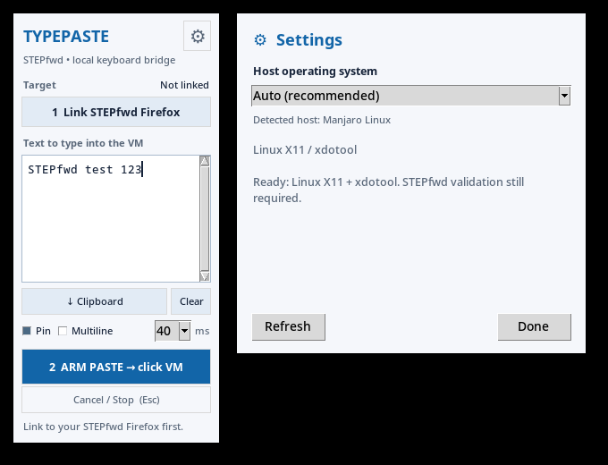

# STEPfwd TypePaste

A small, always-on-top keyboard companion for instructor-approved STEPfwd labs. Paste text into the sidecar, link Firefox, arm, and click inside the VM. The slim UI follows the included [PNG reference](stepfwd-typepaste-v0.2-preview.png).



**v0.4 is a cross-platform preview, not a validated production release.** Native backends and packages exist; the real STEPfwd acceptance matrix still needs to be completed. This is an unofficial local utility, with no STEPfwd API, guest changes, telemetry, or network access in the application.

## What has actually been tested

| Host | Implementation | Evidence | STEPfwd status |
| --- | --- | --- | --- |
| Manjaro X11 | `xdotool` / XTEST, exact window + PID + class | Local unit/UI tests and real XTEST into disposable Tk widgets on Xvfb | User's direct `xdotool` command worked on 2026-11-01; complete sidecar workflow still untested |
| Ubuntu X11 | Same Linux adapter | Unit/UI/Xvfb integration checks and source packaging passed on Ubuntu 24.04 CI | No physical Ubuntu/STEPfwd validation |
| Windows 11 | Native `SendInput`, foreground HWND + PID + Firefox process | API/unit/UI checks and executable packaging passed on Windows Server CI, **not Windows 11** | Experimental; no Windows 11/STEPfwd validation |
| macOS | Quartz + Accessibility focused-window identity | API/unit/UI checks and ARM64 app packaging passed on macOS 14 CI | Experimental; no physical Mac/STEPfwd validation |
| KDE Plasma 6 Wayland | Keyboard-only desktop portal + fresh KWin window UUID/PID/class | Read-only focus and helper-loss checks passed on this Manjaro KDE session; permission protocol tested with an isolated fake portal | Preview; actual Wayland typing into STEPfwd remains untested |
| Other Wayland desktops (including GNOME) | Disabled | No fallback to XWayland | A trustworthy focus adapter is still needed |

See the [dated validation record and successful CI run](docs/VALIDATION.md). CI success establishes the checks it ran, not browser-console compatibility. Windows Unicode `VK_PACKET` and macOS Unicode events can be ignored by remote consoles that only use physical keycodes. Validate a harmless sample in STEPfwd before relying on these backends. Host/guest keyboard layouts and Unicode coverage also need real testing.

## Install and run

Download a package from a successful **Test and package** GitHub Actions run. These are unsigned preview artifacts, not signed/notarized releases.

- **Windows 11:** extract the Windows ZIP and run `TypePaste.exe` as your normal user. Keep Firefox at normal privilege too. No administrator or UAC bypass is used.
- **macOS:** extract the macOS ZIP, move `TypePaste.app` to Applications, and open it. In the gear menu, click **Allow Accessibility…**, grant access in System Settings → Privacy & Security → Accessibility, then **Refresh**. The app never requests Screen Recording. Unsigned previews may be blocked by Gatekeeper; use macOS's normal per-app approval only for a build you trust. Do not disable Gatekeeper. Distributing a production release still requires Developer ID signing and notarization.
- **Manjaro:** install dependencies with `sudo pacman -S --needed python tk xdotool python-gobject xdg-desktop-portal xdg-desktop-portal-kde`, extract the Linux archive, and run `./install.sh`.
- **Ubuntu:** install dependencies with `sudo apt install python3 python3-tk xdotool`, extract the Linux archive, and run `./install.sh`.

Linux installation is per user and requires no root. Dependency installation is a separate, explicit system-administration step. Use **X11**, or **KDE Plasma 6 Wayland** with the setup below. Ubuntu GNOME Wayland is not supported. The launcher appears as **STEPfwd TypePaste**; the app can also run from source:

```bash
python3 stepfwd_sidecar.py
```

Source runs need Python 3.10+ and Tk. macOS additionally needs the pinned bridges in `requirements-macos.txt`, installed in a virtual environment. Windows and Linux X11 have no Python runtime dependencies beyond the standard library; X11 needs the external `xdotool` command. KDE Wayland additionally uses the distro-provided PyGObject/Gio package (no pip build required). Use the system Python so it can find that package.

## KDE Wayland setup

On Manjaro KDE, the dependency command above includes everything. Run `./install.sh` again to update an older installation, then close and reopen TypePaste.

1. Open **⚙ Settings** and leave the host on **Auto**.
2. Click **Enable Wayland…**, then approve keyboard access in KDE's desktop prompt. The prompt may call this “remote control”; TypePaste only uses it locally.
3. Wait for **Ready**, close Settings, and use **Link → Arm → click VM** as usual.

Permission is requested once per app session. TypePaste asks only for keyboard input: no pointer, screen recording or clipboard sharing, and no saved permission token. It loads a temporary, read-only KWin script to check window identity on demand. The script reads no window titles or contents and is unloaded when the backend closes. No manual KWin script installation, root access, `ydotool` daemon or `/dev/uinput` permission is needed.

KDE Plasma 6 on Ubuntu/Kubuntu additionally needs `sudo apt install python3-gi xdg-desktop-portal xdg-desktop-portal-kde`. Installing these packages alone does **not** add Wayland support to GNOME or Plasma 5. The app refuses input if KWin focus checks or lock-screen detection fail. **Refresh** disconnects permission and unlinks Firefox; use **Enable Wayland…** again afterward. If the permission dialog is behind another window, use Alt+Tab to find it. A request expires after two minutes.

Wayland remains a preview. Focus checks were exercised on Manjaro/KWin 6.7.4, but the actual permission dialog and keyboard delivery into STEPfwd still need a user test. Keep Ctrl, Alt, Shift and Super released during typing; this adapter cannot independently inspect held physical modifiers. Start with harmless text and verify case, punctuation and Unicode in the guest. A portal accepting a keysym is not proof that the remote console received it.

## Use

1. Click **1 Link STEPfwd Firefox**, then click the Firefox window containing STEPfwd. Linking times out after 45 seconds.
2. Paste text into the sidecar or click **Clipboard**. The clipboard is read only when you request it.
3. Click **2 ARM PASTE → click VM**, or press Ctrl+Enter in the editor (Command+Enter also works on macOS).
4. Click **directly inside the guest terminal/editor** within 35 seconds. Typing begins as soon as the linked window is detected in focus; there is no countdown or extra start delay. The 35 seconds is only an expiry for an unused Arm.
5. Use **Cancel / Stop**, or Escape while the sidecar is focused, to stop. Losing the linked window's focus stops at the next backend check. Check for partial input before trying again.

**ms/key** is the minimum interval between characters, not a delay before starting. 40 ms is the default; choose 70 or 120 for slower consoles. Backend overhead may make typing slower than the selected interval. Keep modifier keys released while typing. Text stays in the sidecar for repeated use; **Clear** removes it. Opening Settings cancels an active transfer. Changing the host profile or clicking Refresh also discards the target link.

The **gear** chooses the native **host** OS, not the guest Kali OS. Auto is recommended. An incorrect manual override disables Link and Arm and explains why. The settings panel shows backend availability and permission requirements.

## Input safety and limitations

- Explicit Arm is required for every transfer. The backend checks linked window identity before **each character**. Window/application matching never depends on a title substring.
- This is a best-effort guard, not atomic routing: focus can change between inspection and OS event delivery. One in-flight character/key pair can still arrive after a change or cancellation. No desktop automation can promise that window focus alone identifies the guest terminal.
- The trigger is window focus, so switching to the linked window with Alt+Tab also starts an armed transfer. It does not distinguish a physical mouse click.
- A different tab, Firefox's address bar, a browser popup, or a different guest field inside the same linked window may be indistinguishable. Always click the actual VM input area and keep that tab selected.
- No final Enter is added; trailing CR/LF are stripped. Embedded newlines and tabs are blocked by default. **Multiline** opt-in plus a per-transfer confirmation is required for either. Enter can execute commands and Tab can trigger completion or move focus: use a guest text editor.
- NUL, Escape, Backspace, other control characters, invalid surrogates and alternate Unicode line separators are rejected. Text is limited to 20,000 characters.
- Stop is not a global hotkey. Escape only works in the sidecar; clicking Stop also moves focus away from Firefox. Cancellation cannot undo input already sent.
- No clipboard text, target IDs, histories or permission choices are persisted. Only geometry, host profile and typing delay are saved. Multiline always starts disabled.
- Preferences: Linux `$XDG_CONFIG_HOME/stepfwd-typepaste/preferences.json` (default `~/.config`); Windows `%LOCALAPPDATA%/stepfwd-typepaste/preferences.json`; macOS `~/Library/Application Support/stepfwd-typepaste/preferences.json`.

On KDE Wayland, each focus query requires a new nonce-bound reply from the current KWin process. Stale replies, compositor loss, a locked screen, unavailable lock state, and permission revocation stop input. Keyboard key-up is attempted even when a key-down call fails. Other Wayland desktops remain unavailable; XWayland metadata is never used as a substitute for compositor focus.

## Fullscreen and two monitors

Drag the roughly 230-pixel sidecar into STEPfwd's white margin. **Pin** requests always-on-top; fullscreen stacking is controlled by the desktop. On KDE, create a KWin window rule matching only `STEPfwdTypePaste` or the exact title and try **Keep Above**. If your KWin version exposes a **Layer → Overlay** rule, it may help. Otherwise maximize Firefox without F11, keep TypePaste on the other monitor, or leave fullscreen to arm it. Other desktops and macOS fullscreen Spaces may require the same alternatives.

## Tests and builds

The test-first history includes failing contract commits followed by implementations. Native API tests use fakes and emit no real input. UI tests use a fake backend. X11 integration tests require explicit opt-in and verify they are on Xvfb before touching focus metadata.

```bash
python3 -m unittest -v test_core.py test_native.py test_wayland.py
python3 -m py_compile stepfwd_sidecar.py
TYPEPASTE_REQUIRE_GUI=1 xvfb-run -a python3 -m unittest -v test_ui.py
TYPEPASTE_X11_TEST=1 xvfb-run -a python3 -m unittest -v test_x11_integration.py
# Linux: real D-Bus transport, fake portal on a separate bus; no desktop input
TYPEPASTE_DBUS_TEST=1 dbus-run-session -- python3 -m unittest -v test_wayland_dbus.py
# Optional on a real KDE Wayland desktop: read-only focus checks, no typing
TYPEPASTE_KWIN_TEST=1 python3 -m unittest -v test_wayland_focus.py
```

Build on the destination operating system:

```bash
# Manjaro / Ubuntu: source bundle, no Python build dependencies
./scripts/build-linux.sh

# macOS: installs pinned build dependencies in .venv
./scripts/build-macos.sh
```

On Windows with Python 3.12 installed, run `scripts/build-windows.ps1` from PowerShell. It creates `.venv` and runs the tests before packaging. Outputs go to `dist/`. The Linux bundle uses the host's Python/Tk and chosen backend dependencies to avoid incompatible bundled glibc versions across distros. GitHub Actions runs unit tests, GUI smoke checks and native packaging on Ubuntu, Windows Server and macOS; Linux also runs Xvfb integration and isolated portal transport tests. It uploads artifacts without publishing a public release.

## Architecture and release gate

- `stepfwd_sidecar.py`: compact Tk UI; no native keyboard or focus code.
- `typepaste/core.py`: explicit link/arm/type lifecycle, timeouts, generation-safe cancellation and worker isolation.
- `typepaste/backends/`: typed target/capability records and separate Linux, Windows and macOS adapters.
- `typepaste/preferences.py`: atomic, allowlisted preference writes.

Before claiming production support, complete [the real-machine acceptance checklist](CODEX_HANDOFF.md), validate packaged launches on the destination hardware and STEPfwd, and sign/notarize native releases. Never claim CI fakes or Xvfb prove the remote VM accepted text.

Implementation references: [Microsoft SendInput](https://learn.microsoft.com/en-us/windows/win32/api/winuser/nf-winuser-sendinput), [Apple Accessibility trust](https://developer.apple.com/documentation/applicationservices/1459186-axisprocesstrustedwithoptions), [PyObjC ApplicationServices](https://pyobjc.readthedocs.io/en/latest/apinotes/ApplicationServices.html), [PyInstaller native builds](https://pyinstaller.org/en/stable/), [RemoteDesktop portal](https://flatpak.github.io/xdg-desktop-portal/docs/doc-org.freedesktop.portal.RemoteDesktop.html), [KWin scripting API](https://develop.kde.org/docs/plasma/kwin/api/).
